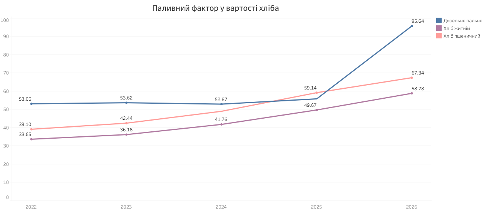

# Економіка воєнного часу: Аналіз динаміки споживчих цін в Україні (2022–2026 рр.)

Автор: Olena Tymus  
Статус проєкту: Фінальне аналітичне дослідження для бізнес-видання Observer Business (у межах стажування).

##  Вступ та актуальність дослідження
Повномасштабна війна в Україні спровокувала масштабні структурні зсуви в макроекономіці. Руйнування виробничих потужностей, блокування традиційних логістичних маршрутів, енергетичні кризи та дефіцит кадрів спричинили безпрецедентний інфляційний тиск на споживчий ринок. 

Метою цього дослідження є детальний аналіз реальних роздрібних цін на маркерні продукти харчування та пальне в Україні. На основі офіційних очищених даних Державної служби статистики України (Держстат) було розроблено систему інтерактивних дашбордів у Tableau та сформовано глибокі аналітичні висновки для бізнес-спільноти. Базовим періодом дослідження обрано вересень 2022 року, фінальною точкою — осінь 2026 року.

##  Матеріали та джерела проєкту
*   Інтерактивні дашборди: [(https://public.tableau.com/app/profile/olenka.tymus/viz/_17939583140370/sheet7?publish=yes)]
*   Очищений Data Source (Excel): [ Завантажити набір даних](./Inflation_Data_Clean_1.xlsx) (файл зафіксовано в репозиторії для прозорості дослідження)

---
##  Глибокий цифровий аналіз даних та інсайти

### 1. Перший дашборд: Загальний інфляційний тренд та зріз ринку
Перша візуалізація демонструє безперервну хронологію роздрібних цін та точну порівняльну матрицю вересневих показників.

.png)

####  Аналіз роздрібних цін та чистих змін (Вересень 2022 vs Вересень 2026 рр.):
На основі сформованої матриці «Ціновий зріз та інфляція» зафіксовано такі критичні макроекономічні маркери:

*   Антилідери паливного сектору: Дизельне пальне продемонструвало найбільше зростання серед енергоносіїв на +80,2%, злетівши з 53,1 грн до 95,6 грн. Бензин А-95 подорожчав на +74,0%, піднявшись із 49,3 грн до 85,8 грн. Це заклало руйнівний інфляційний імпульс у логістику всіх споживчих товарів.
*   Продовольча інфляція соціальної групи:
   *  М'ясна група: Яловичина продемонструвала безпрецедентний абсолютний стрибок на +93,5%, подорожчавши з 200,9 грн до 388,8 грн. Свинина зросла на +43,7% (зі 164,3 грн до 236,1 грн), а Філе куряче — на +57,7% (зі 137,7 грн до 217,1 грн).
    *   Молочна продукція та жири: Масло вершкове злетіло на +76,4% (з 61,5 грн до 108,6 грн), Молоко подорожчало на +60,3% (з 32,9 грн до 52,8 грн), а Сметана зросла на +71,8% (з 88,0 грн до 151,2 грн). Сири м'які жирні збільшилися в ціні на +66,2% (зі 148,1 грн до 246,2 грн).
    *   Базові вуглеводи та бакалія: Хліб житній подорожчав на +74,7% (з 33,7 грн до 58,8 грн), а Хліб пшеничний — на +72,2% (з 39,1 грн до 67,3 грн). Олія соняшникова піднялася на +46,6% (з 69,9 грн до 102,4 грн), а Борошно пшеничне — на +37,0% (з 17,2 грн до 23,6 грн).
*   Група воєнної дефляції та стабілізації (Показники зі зниженням):
На тлі загального подорожчання маркерні вуглеводи та крупи продемонстрували унікальний дефляційний тренд, зумовлений повною адаптацією внутрішнього ринку та перевищенням пропозиції над попитом:
    *   Крупи гречані: продемонстрували чисте падіння на -11,8%, знизившись з 89,8 грн до 79,2 грн. Панічний дефіцит 2022 року змусив аграріїв рекордно збільшити площі посівів гречки, що повністю збило ціну в наступні роки.
    *   Цукор: знизився в ціні на -5,0%, скорегувавшись із 35,6 грн до 33,8 грн.
    *   Рис: показав дефляційну динаміку на рівні -3,5%, знизившись із 58,5 грн до 56,4 грн завдяки налагодженню нових стабільних імпортних коридорів.
   

---

### 2. Другий дашборд: Драйвери та причинно-наслідкові зв'язки
Другий екран фокусується на глибинних економічних залежностях та фіксує точні ринкові фактори впливу.

.png)


*   Синхронність «Пальне ➔ Хліб»: Графік наочно доводить, що паливний шок є першопричиною продовольчої інфляції. Кожне підняття акзиців чи дефіцит пального автоматично відображається на вартості хліба через логістичні витрати.

 *   М'ясний кошик (Яловичина vs Курятина): Дані фіксують утворення величезних «ножиць цін». До кінця 2026 року яловичина перетворилася на дорогий делікатес через падіння виробництва, тоді як куряче філе утримує позицію найбільш доступного і масового джерела білка для населення.


---

##  Стратегічні висновки для Observer Business

1.  Жорстка оптимізація споживчого кошика: Оскільки ціни на базові продукти та логістику зросли у 2-3 рази, українські домогосподарства вимушено змістили свої витрати виключно на продукти першої потреби. Це спричиняє затяжну кризу та падіння прибутків у непродовольчих секторах (побутова техніка, одяг, сфера послуг).
2.  Тиск на комерційний сектор: Нова хвиля паливного зростання (дизель до 95,6 грн) змушує бізнес переглядати маржинальність та закладати вищі ризики в бюджети.
3.  Критерій для HR-директорів: В умовах глибокого дефіциту кадрів компанії повинні розуміти, що номінальне підвищення зарплат не працює — реальна вартість базового життя співробітника подвоїлася, що потребує повної перебудови систем мотивації.

---

##  Технічний стек проєкту

*   Data Source: Державна служба статистики України.
*   ETL & Очищення: Microsoft Excel (абсолютна фільтрація за географічним маркером «Україна», вибірка маркерів).
*   BI-Візуалізація: Tableau Public (реалізовано механізм Pivot Table для часових рядів, розроблено кастомні ізольовані формули для років через `IF YEAR([Date])` та Master-Detail інтерактивні фільтри-екшни).
*   Хостинг: GitHub (Markdown документація).
